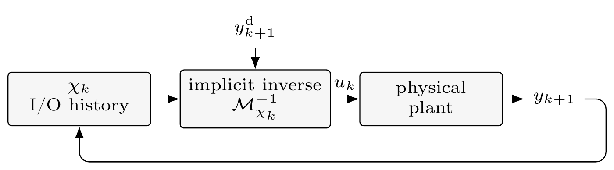

# Implicit Deep Learning Models for Robust Nonlinear Inverse Control

**Giuseppe C. Calafiore and Laurent El Ghaoui**

Reproducibility package for the accompanying manuscript. The repository contains
the numerical studies and their trained checkpoints, together with scripts for
regenerating the reported tables and figures.

An implicit predictor represents hidden features by an equilibrium equation.
Algebraic elimination of the explicit input channel produces a consistent inverse
of the same fitted model. The control certificate propagates measured-history
errors through a nonnegative comparison system and accounts for finite inverse
solver accuracy.

<p align="center">
  
</p>

## Quick start

The validated environment is **Python 3.13.5 on Linux x86_64, using CPU PyTorch**.
The experiment code uses one PyTorch thread. No external dataset is required;
all benchmark data are generated from the supplied equations and seeds.

```bash
python3.13 -m venv .venv
source .venv/bin/activate

# Install the official CPU build first, then the remaining pinned dependencies.
python -m pip install torch==2.10.0 --index-url https://download.pytorch.org/whl/cpu
python -m pip install -r requirements.txt

python reproduce.py check
python reproduce.py test
python reproduce.py checkpoints --output runs/paper-checkpoints
```

The final command regenerates all three studies from the saved model weights. It
writes six experimental figure pairs and a numerical comparison report. The
four manuscript tables are exported in CSV, Markdown, and LaTeX. The command
returns a nonzero exit status when checkpoint regression tolerances are exceeded.

Every run uses a **new workspace**. The paper's reference files in `results/` and
`figures/` remain unchanged. Omitting `--output` creates a timestamped directory
under `runs/`; supplying an existing output directory is an error.

## Reproduction routes

| Command | Purpose |
| --- | --- |
| `python reproduce.py check` | Verify the SHA-256 hashes of the 21 frozen scientific inputs. |
| `python reproduce.py test` | Run 20 unit and scientific-equation tests. |
| `python reproduce.py checkpoints` | Regenerate all evaluations from supplied model weights. |
| `python reproduce.py train` | Retrain all models from scratch, then evaluate them. |
| `python reproduce.py audit` | Check NARX tubes and transients, including independent equation tests. |
| `python reproduce.py tables` | Export tables directly from the archived JSON; no numerical libraries needed. |

Add `--experiment static`, `--experiment narx`, or `--experiment servo` to the
checkpoint and training commands to run one study. A small inversion example is
available through `python examples/minimal_inverse.py`.

The checkpoint route replays the random minibatch draws that the original
training calls would consume. This preserves the later random draws while
skipping optimization. Training uses the original optimizer routines. See
[reproduction details](docs/REPRODUCIBILITY.md) for the comparison policy.

## Experiments and reference results

**Static MIMO inversion** compares the algebraic inverse with a separately trained
inverse and Newton root finding. The **nonlinear NARX study** evaluates the
measured-history certificate and its architectural ablations. The
**physics-guided servo** evaluates uncertain closed-loop position tracking using
a scalar voltage-to-next-velocity inverse.

| Reference quantity | Archived value |
| --- | ---: |
| NARX main-model certificate, rho(H) | 0.67067983 |
| NARX implicit-inverse mean tracking RMSE | 0.00576451 |
| NARX direct-inverse mean tracking RMSE | 0.00575133 |
| Servo implicit-inverse mean position RMSE | 0.04365107 |
| Servo direct-inverse mean position RMSE | 0.06717828 |

See [all four tables](tables/TABLES.md) and the
[figure and result map](docs/RESULTS_GUIDE.md). The complete implementation
supplement is [NUMERICAL_DETAILS.md](NUMERICAL_DETAILS.md).

The probabilistic calibration statement applies to the fixed main NARX
closed-loop law over a 280-step horizon. Variant tube calculations use
preliminary envelopes. The servo example is an empirical state-informed tracking
study. These distinctions are documented in the numerical supplement.

## Validation

The complete checkpoint rerun passed **2,446 numerical comparisons**, with timing
and stopping-count diagnostics reported separately. All 20 unit tests passed.
The independent tests covered 36 dense cyclic models, with 64 queries per model.
Full from-scratch training and evaluation also completed; the resulting numerical
differences are retained in the training comparison report.

The supplied weights are the reference for reproducing the paper's tables.
Retraining results are recorded separately. The validation environment and all
checks are documented in [validation/REPORT.md](validation/REPORT.md).

## Repository layout

```text
code/              Frozen scientific scripts from the current source package
scripts/           Safe-run support and table exporters
examples/          Minimal checkpoint inversion example
tests/             Unit and scientific regression tests
results/           Original model weights and paper result files
figures/           Original experimental graphics and architecture drawing
tables/            Generated table exports and portable numeric results
docs/              Reproduction guide and release instructions
validation/        Local run reports and environment records
.github/workflows/ Automated smoke tests and manual full reproduction
```

The original `code/experiments.py` and `code/review_checks.py` update the
root-level outputs when called directly. Use `reproduce.py` for normal runs.

## Citation and release status

Citation metadata is in [CITATION.cff](CITATION.cff); a BibTeX entry is supplied in
[CITATION.bib](CITATION.bib). The manuscript is identified as unpublished pending
bibliographic updates. Repository and DOI fields can be added at release time.

The source package contained no explicit software license. The repository owner
should complete the [license selection](LICENSE_STATUS.md) before public release.
The [release checklist](docs/RELEASE_CHECKLIST.md) includes the GitHub upload and
archival steps.

This work is financially supported by the VinUniversity Center for Environmental
Intelligence under Grant No. VUNI.CEI.FS_0015, as acknowledged in the manuscript.
